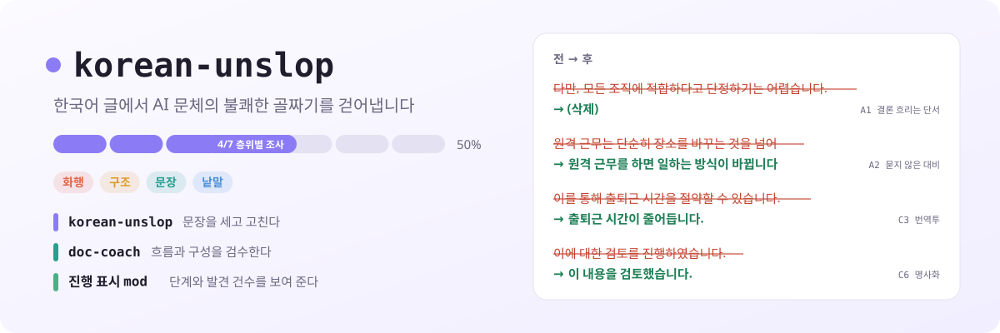
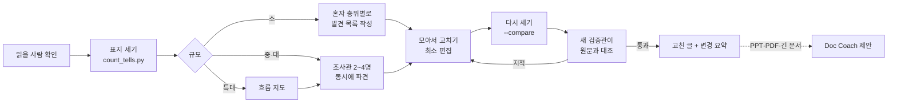
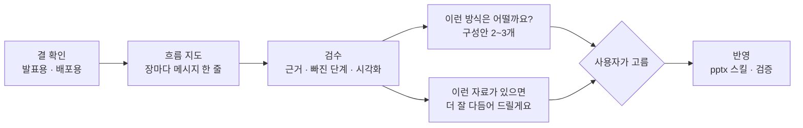
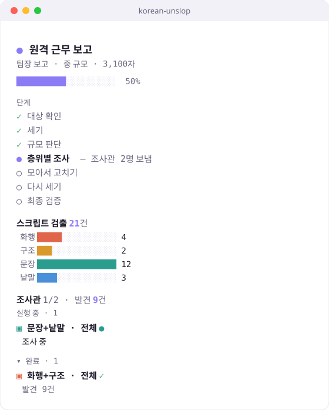

<div align="center">

<picture>
  <source media="(prefers-color-scheme: dark)" srcset="docs/assets/banner-dark.svg">
  
</picture>

# korean-unslop

**한국어 글에서 AI 문체의 불쾌한 골짜기를 걷어내는 Claude Code 플러그인**

문법은 맞는데 묘하게 읽기 싫은 글이 있습니다. 결론을 흐리는 "다만", 묻지도 않은 "A가 아니라 B", 문장마다 붙은 "~를 통해", 여덟 번 이어지는 "~했습니다".<br>
korean-unslop은 한국 독자가 실제로 AI 티라고 지적한 표지를 세고, 글의 자리와 읽을 사람에 맞게 고쳐 씁니다.<br>
PPT와 보고서는 문장을 고친 뒤 전체 흐름까지 검수해 더 나은 구성을 제안합니다.

[](#설치)
[](.claude-plugin/plugin.json)
[](#들어-있는-것)
[](skills/korean-unslop/scripts)
[](#사용법)

[전과 후](#전과-후) · [들어 있는 것](#들어-있는-것) · [설치](#설치) · [사용법](#사용법) · [어떻게 고치나](#어떻게-고치나) · [Doc Coach](#doc-coach-흐름과-구성-검수) · [진행 표시](#진행-표시-claude-code) · [근거](#근거) · [한계](#한계)

</div>

---

## 전과 후

팀장에게 올릴 원격 근무 검토 보고. GPT가 뽑은 초안을 고쳤습니다.

<table>
<tr><th width="50%">전 (432자)</th><th width="50%">후 (197자)</th></tr>
<tr><td>

최근 원격 근무가 큰 주목을 받고 있습니다. 오늘은 원격 근무의 장단점에 대해 알아보겠습니다.

원격 근무는 단순히 장소를 바꾸는 것을 넘어, 일하는 방식 자체를 바꾸는 변화입니다. 이를 통해 직원들은 출퇴근 시간을 절약할 수 있습니다. 또한, 업무 몰입도가 높아질 수 있습니다.

다만, 원격 근무가 모든 조직에 적합하다고 단정하기는 어렵습니다. 소통 측면에 있어서 어려움이 발생할 수 있습니다. 따라서 신중한 검토가 필요합니다.

결론적으로, 원격 근무는 기술·문화·제도 측면에서 종합적인 접근을 통해 성공적으로 정착될 수 있습니다. 이는 조직의 경쟁력 제고에 기여할 것이며, 시사하는 바가 큽니다.

원하시면 체크리스트도 만들어 드릴까요? 😊

</td><td>

원격 근무를 주 2회로 시범 도입하자고 제안합니다.

원격 근무를 하면 출퇴근에 쓰던 시간이 줄고 집중해서 일할 시간이 늘어 생산성이 오를 것으로 봅니다. 사무실 운영 비용도 줄어듭니다. 지역에 매이지 않고 사람을 뽑을 수도 있습니다.

걸리는 점은 소통입니다. 같은 공간에 있지 않으면 소통이 어려워질 수 있고, 이 방식이 우리 조직에 맞을지는 해 보기 전에는 알기 어렵습니다. 그래서 주 2회로 시작해 소통에 문제가 생기는지 먼저 확인하려고 합니다.

</td></tr>
</table>

고친 글 아래에는 무엇을 왜 바꿨는지 짧은 요약이 붙습니다. 원문에 없는 숫자나 경험은 지어 넣지 않고, 비어 있는 곳은 "확인 필요"로 따로 짚습니다.

## 들어 있는 것

| | 하는 일 | 부르는 법 |
|---|---|---|
| **korean-unslop** 스킬 | 문장 단위로 AI 문체를 세고 고친다. 보고서, 메일, 메신저, 블로그, 기술 문서, 자소서, PPT, PDF | "AI 티 없애줘", "자연스럽게 다듬어줘", `/korean-unslop` |
| **doc-coach** 스킬 | PPT, PDF, 긴 보고서의 흐름과 구성을 검수하고 구성안을 제안한다. 부족한 자료는 요청한다 | "발표 자료 흐름 봐줘", "장표 순서 괜찮아?", `/doc-coach` |
| **진행 표시** mod | 지금 단계, 검출 건수, 조사관별 담당과 발견 건수를 프롬프트 위 띠, 패널, 상태줄에 보여 준다 | 스킬을 쓰면 저절로. `/unslop-progress` |

## 설치

### 마켓플레이스로 (권장)

Claude Code에서:

```
/plugin marketplace add sangwookp9591/korean-unslop
/plugin install korean-unslop@korean-unslop
```

Claude Code 2.1.275 이상이면 한 줄로도 됩니다.

```
/plugin install korean-unslop --marketplace sangwookp9591/korean-unslop
```

두 스킬과 진행 표시 mod가 함께 설치됩니다. 새 세션을 열면 잡힙니다. 업데이트는 `/plugin update korean-unslop`.

### 스킬 폴더에 직접

플러그인 없이 스킬만 쓰고 싶다면 아래처럼 복사합니다. 이 방법으로는 진행 표시 mod가 켜지지 않습니다.

```bash
git clone https://github.com/sangwookp9591/korean-unslop.git
cp -r korean-unslop/skills/korean-unslop korean-unslop/skills/doc-coach ~/.claude/skills/
```

특정 프로젝트에서만 쓰려면 `~/.claude/skills/` 대신 그 프로젝트의 `.claude/skills/`에 넣으면 됩니다.

### PPT를 화면으로 검수하려면 (선택)

슬라이드를 이미지로 렌더링해 잘림과 겹침까지 보려면 LibreOffice와 Poppler가 필요합니다. 없어도 텍스트와 노트로 검수합니다.

```bash
sudo apt install -y libreoffice-impress poppler-utils      # Ubuntu, WSL
brew install --cask libreoffice && brew install poppler    # macOS
```

## 사용법

스킬 이름을 부르지 않아도 됩니다. 이런 요청이면 알아서 동작합니다.

```
이 보고서 AI 티 너무 나는데 팀장님께 올릴 수 있게 고쳐줘  (파일 경로나 본문 붙여넣기)
자소서 지원동기 챗GPT로 쓴 거 티 날까봐 걱정돼요. 자연스럽게 다듬어 주세요
PR 설명인데 개발자들끼리 보는 톤으로 고쳐줘
deck.pptx 투자 미팅 자료인데 슬라이드 문구가 너무 AI 같아요. 발표자 노트도요
이 PDF 보고서 문장만 좀 사람이 쓴 것처럼 바꿔줘
이 글 AI 같아?                       (고치지 않고 진단만)
분기 보고 덱 흐름 좀 봐줘, 임원 보고용이야   (doc-coach)
```

| 입력 | 결과 |
|---|---|
| 붙여 넣은 글 | 채팅에 고친 글과 변경 요약 |
| `.md` `.txt` 파일 | 원본은 두고 `<이름>.unslop.md`로 저장 |
| `.pptx` | 서식과 이미지를 유지한 채 문단만 고쳐 `<이름>.unslop.pptx`로 저장, 슬라이드별 전후 요약. 끝나면 흐름 검수를 제안 |
| PDF | 페이지별로 "원문 → 고친 글". PDF 파일은 고치지 않음. 끝나면 흐름 검수를 제안 |

Claude가 한국어 블로그 글, 보고서, 메일, README를 새로 쓸 때도 korean-unslop의 작성 지침을 따릅니다.

## 어떻게 고치나

기본은 **최소 편집**입니다. 첫 문장부터 전부 다시 쓰지 않고, 독자가 멈출 만한 구절을 찾아 그 부분을 고칩니다. 원래 자연스러운 문장은 그대로 둡니다.



1. **읽을 사람을 묻는다.** 같은 글도 팀장 보고, 동료 공유, 고객 안내에 따라 고칠 방향이 다릅니다. 요청에 대상이 드러나 있으면 묻지 않습니다.
2. **센다.** `count_tells.py`가 표지별 횟수, 1000자당 밀도, 같은 어미 연속, 문장 길이의 고른 정도, 서식 비중을 셉니다.
3. **규모를 판단해 인원을 제시한다.** 글이 크고 복잡할수록 흐름을 읽어야 하니 인원을 늘립니다. 중 규모 이상은 계획을 먼저 보여 주고 고르게 합니다.

   | 규모 | 공백 제외 | 구성 |
   |---|---|---|
   | 소 | 1,500자 이하 (메신저, 메일, PR, 자소서 한 문항) | 혼자 처리 |
   | 중 | 1,500~5,000자 (보고서 몇 쪽, 블로그, PPT 15장 이하) | 조사관 2명 + 검증관 |
   | 대 | 5,000~15,000자 (기획서, PPT 15~40장) | 조사관 4명 + 검증관 |
   | 특대 | 15,000자 초과 (여러 장 문서, 40장 넘는 덱) | 흐름 지도 먼저 → 전체 조사관 2명 + 구간 조사관 n명 + 검증관 |

   제출용이나 대외 공개 글, 여러 장르가 섞인 글은 한 단계 올리고, "빨리"라고 하면 한 단계 내립니다.
4. **층위별로 따로 조사한다.** 중 규모 이상은 글 전체를 한 번에 보지 않습니다. 규모에 맞는 수의 조사관을 동시에 보내 각자 맡은 층위만 봅니다(화행, 구조·내용, 문장, 낱말·분야). 특대 규모는 문장과 낱말을 구간별로 나눕니다. 조사관은 고친 글이 아니라 줄 번호, 표지, 수정안, 확신을 적은 발견 목록만 돌려줍니다.
5. **모아서 고친다.** 겹치는 발견은 위 층위를 따르고, 조사관이 "고치지 말 것"으로 적은 구절은 남깁니다. 원문에 근거가 없는 곳은 지어내지 않고 `[성과 수치]` 같은 빈칸으로 남겨 묻습니다.
6. **다시 센다.** `--compare`로 전후를 비교합니다.
7. **최종 검증.** 조사에 참여하지 않은 검증관이 원문과 고친 글만 보고 사실·조건 보존, 확신 정도, 지어낸 내용, 남은 표지, 과교정을 확인합니다. 지적은 한 번 더 고치고, 그 뒤에도 남는 것은 "확인 필요"로 넘깁니다.

소 규모나 에이전트를 쓸 수 없는 환경에서는 같은 순서를 혼자 층위 하나씩 진행합니다.

## 무엇을 고치나

| 층위 | 표지 | 예 |
|---|---|---|
| **화행** (빼야 고쳐진다) | 결론을 흐리는 단서, 묻지 않은 부정, 아첨, 후속 제안, 예고, 작위적 공손 | "다만 단정하기 어렵습니다", "단순히 ~를 넘어", "핵심을 찔렀어요", "원하시면 ~해드릴까요?", "알아보겠습니다" |
| **구조** | 거창한 마무리, 공허한 중요성, 찍어낸 틀, 셋씩 묶기 | "시사하는 바가 큽니다", "~이 중요합니다", 모든 답에 소제목과 볼드 |
| **문장** | 문두 접속어, 지시어, 번역투, 이중 피동, 명사화, 가능성 남발, 같은 어미 반복, 쉼표 과다, 대명사 채우기, 잘게 끊긴 단문, 행위자가 숨은 문장 | "또한,", "이는", "~에 있어서", "보여집니다", "검토를 진행하였습니다", "그의 손을", "데이터가 말해 준다" |
| **낱말·기호** | 엠대시, 가운뎃점 나열, →, 볼드, 장식 이모지, 강조 따옴표, 판교어 과다, 그 분야에서 안 쓰는 동사 | "기획·개발·운영", "🚀 주요 기능", "burn-in으로 셌습니다", "장치를 넣었습니다" |
| **내용** (문체로는 못 고친다) | 경험·구체성 부재, 지어낸 감정, 같은 말 반복 | "많은 도움이 됩니다", 출처 없는 "최근 연구에 따르면" |

표지마다 근거, 전후 예시, 남겨도 되는 경우는 [patterns.md](skills/korean-unslop/references/patterns.md)에 있습니다. 번역투는 국립국어원과 신문 교열 기준의 예문으로 만든 [대안표](skills/korean-unslop/references/translationese.md)를 따릅니다. "마케팅에 있어서" → "마케팅에서", "AI를 통해" → "AI로".

### 고치지 않는 것

- 인용문, 고유명사, 법률·학술 문서의 관례 표현, 코드와 명령
- 보고서·PPT의 개조식과 명사 종결, ■ ▶ - 위계, 표와 절차 목록
- 팀이 실제로 쓰는 실무 용어("얼라인", "PR", "스프린트"). 사전식으로 번역하지 않습니다
- 분야에서 자리 잡은 표현("빌드가 깨졌다", "컴파일이 끝나면")
- 원문 작성자의 높임 수준과 말버릇

### 하지 않는 것

| 하지 않는 방식 | 이유 |
|---|---|
| "단순히", "또한", "이를 통해", 쉼표를 전부 금지 | 정상적인 대조, 연결, 호흡까지 망가진다 |
| 무조건 짧게 쓰고 일정 비율 이상 삭제 | 조건과 인과가 빠지거나 명사만 이어 붙는다 |
| 목록, 소제목, 표를 전부 제거 | 절차와 비교에서는 읽기를 돕는다 |
| 오타, 반말, 밈으로 사람처럼 보이게 하기 | "젊은 척하는 AI"라는 두 번째 골짜기가 생긴다 |
| 경험, 숫자, 감정을 새로 넣어 구체화 | 문체를 고치다 사실을 지어내게 된다 |
| 탐지 점수나 "AI일 확률" 출력 | 읽기 쉬움과 생성 여부를 혼동하게 한다 |
| 친절함을 모두 제거 | 공감을 장점으로 느끼는 독자도 있다 |
| 문장마다 간결성 규칙을 기계적으로 적용 | 호흡, 강조, 감정 조절이 무너진다 |

### 장르별 목표 문체

[genres.md](skills/korean-unslop/references/genres.md)에 장르마다 사람이 쓴 글의 모습, 자주 나오는 AI 표지, 남길 것을 정리했습니다. 업무 문서와 보고서, 발표 자료(PPT)와 PDF, 업무 메일, 업무 메신저(슬랙, 카톡), 블로그와 SNS, 기술 문서(README, PR), 자소서와 지원서.

## Doc Coach: 흐름과 구성 검수

문장이 다 매끄러워도 순서가 엇나가거나 근거가 빠지면 읽는 사람은 설득되지 않습니다. PPT, PDF, 긴 보고서는 문장을 고친 뒤 이렇게 묻습니다.

> 문장은 다 다듬었습니다. 전체 흐름이나 내용도 봐드릴까요? 발표용인가요, 배포용 보고서인가요?



1. **결 확인:** 발표용(발표자가 설명) / 배포용(혼자 읽음) / 발표 후 배포. 누가 읽고 무엇을 판단하는지.
2. **흐름 지도:** 장마다 메시지 한 줄과 역할. 제목만 이어 읽어도 논리가 이어지는지.
3. **검수:** 근거·출처·기준일·단위, 빠진 단계, 시각화가 내용의 관계(비교, 추세, 구성비, 과정, 일정)에 맞는지. 발표용은 글 양과 발표자 노트, 배포용은 혼자 읽어도 이해되는지.
4. **"이런 방식은 어떨까요?":** 순서, 제목, 시각화 대안을 전후로 보여 주고 고르게 합니다.
5. **"이런 자료를 보여 주시면 더 잘 다듬어 드릴게요":** 흐름이 끊긴 곳에 필요한 자료를 구체적으로 요청합니다.
6. **반영:** 고른 것만. 문구는 새 파일에 반영하고, 슬라이드 순서 변경·추가·삭제는 `pptx` 스킬로 반영한 뒤 호환성을 검증합니다. `pptx` 스킬이 없으면 장별 변경 지시로 정리합니다.

실무 원칙(결론 먼저, 한 장 한 메시지, 개조식, 3분할, 숫자 강조)은 출발점으로만 씁니다. 무조건 체언 종결, 매 장 3분할은 기본 규칙이 아닙니다. 적용과 조정 기준은 [principles.md](skills/doc-coach/references/principles.md), 검수 항목은 [review-checklist.md](skills/doc-coach/references/review-checklist.md).

### 함께 쓰는 기본 스킬

파일을 열고 보이고 고치는 일은 기본 스킬에 맡깁니다. 없으면 텍스트만으로 진행합니다.

| 기본 스킬 | 쓰는 곳 |
|---|---|
| Anthropic `pptx` | 슬라이드 텍스트·표·차트 데이터·노트 추출, 썸네일 그리드, 렌더링해서 잘림·겹침 확인, 슬라이드 복제·순서 변경·삭제, PowerPoint 호환성 검증 |
| `pdf-viewer` 플러그인 | 검수에서 찾은 문제를 PDF 페이지 위에 강조와 주석으로 표시해 함께 넘겨 보기. PPTX는 렌더링한 PDF로 |
| Anthropic `pdf` | PDF 표 추출, 페이지 분리·병합 |

## 진행 표시 (Claude Code)

플러그인으로 설치하면 mod가 함께 켜져서, 고쳐 쓰는 동안 무엇이 진행 중인지 세 곳에 보여 줍니다.

**프롬프트 위 띠.** 입력창 바로 위에 한 줄로 보입니다. `×2`(지금까지 보낸 조사관 수)를 누르면 패널이 열리고 `✕`로 닫습니다.

<div align="center">

<picture>
  <source media="(prefers-color-scheme: dark)" srcset="docs/assets/band-dark.svg">
  
</picture>

</div>

터미널에서는 한 줄 텍스트로 그립니다.

```
● 원격 근무 보고  █████████░░░░░░░░░░░  4/7 층위별 조사  50%  발견 9  ×2  ✕
```

데스크톱 앱에서는 단계마다 한 칸인 둥근 막대로 그리고, 지금 단계 칸이 천천히 깜빡입니다. 다크 모드 색을 따로 두고, 움직임 줄이기 설정을 켜면 멈춥니다.

**패널.** 채팅 옆에 단계, 검출 건수, 조사관을 펼쳐 보여 줍니다. `/unslop-progress`로 다시 엽니다.

<div align="center">

<picture>
  <source media="(prefers-color-scheme: dark)" srcset="docs/assets/pane-dark.svg">
  
</picture>

</div>

<details>
<summary>텍스트로 보기</summary>

```
● 원격 근무 보고                     간단히
팀장 보고 · 중 규모 · 3,100자
██████████░░░░░░░░░░ 50%

단계
✓ 대상 확인
✓ 세기
✓ 규모 판단
● 층위별 조사 — 조사관 2명 보냄
○ 모아서 고치기
○ 다시 세기
○ 최종 검증

스크립트 검출 21건
  화행 █████░░░░░░░░░░░ 4
  구조 ███░░░░░░░░░░░░░ 2
  문장 ████████████████ 12
  낱말 ████░░░░░░░░░░░░ 3

조사관 1/2 · 발견 9건
실행 중 · 1
▣ 문장+낱말 · 전체 ●
  조사 중

▾ 완료 · 1
▣ 화행+구조 · 전체 ✓
  발견 9건
```

</details>

- 단계 기호: `✓` 완료(초록), `●` 진행 중(강조색), `○` 대기(흐림). 조사 단계는 끝난 조사관 비율만큼 막대가 찹니다.
- 조사관은 층위마다 색이 다른 `▣`로 구분합니다. 화행은 주황, 구조는 황토, 문장은 청록, 낱말은 파랑, 검증은 초록입니다.
- "간단히"를 누르면 한 줄 요약으로, "▾ 완료"를 누르면 끝난 조사관을 접습니다. 접은 상태는 다시 불러와도 유지됩니다.
- Doc Coach는 같은 자리에 결 확인부터 반영까지 6단계와 `5 문제 · 2 제안 · 1 자료 요청`, 흐름 지도 조각을 보여 줍니다.

**상태줄.** `korean-unslop · 4/7 층위별 조사 · 50% · 조사관 1/2 · 발견 9건`

정보는 이렇게 모읍니다.
- **단계와 검출 건수:** 스킬이 단계마다 부르는 `progress` 도구로 갱신합니다.
- **조사관과 검증관:** 에이전트 이름(`unslop 조사관 문장 1-120줄`)에서 맡은 층위와 범위를, 보고의 발견 목록 행 수에서 발견 건수를, 검증 보고에서 판정과 지적 건수를 읽습니다.
- 이름이 `unslop`이나 `coach`로 시작하지 않는 에이전트는 표시하지 않습니다.

## 스크립트만 쓰기

두 스크립트 모두 파이썬 표준 라이브러리만 씁니다. 설치할 것이 없습니다.

```bash
S=skills/korean-unslop/scripts

# AI 표지 집계
python3 $S/count_tells.py 글.md
python3 $S/count_tells.py 글.md --json                 # layer_counts, plan(규모 제안) 포함
python3 $S/count_tells.py 원문.md --compare 고친글.md

# PPTX 문단 추출과 적용
python3 $S/office_text.py extract deck.pptx --json paras.json --md deck.txt --notes
python3 $S/office_text.py apply deck.pptx edits.json deck.unslop.pptx   # edits.json: {"slide3:p2": "새 문장"}
```

<details>
<summary><code>count_tells.py</code> 출력 예</summary>

```
# AI 문체 표지 집계

- 글자 수(공백 제외): 432, 문장 수: 17
- 문장 길이 평균 25자, 변동계수 0.29 ← 문장 길이가 너무 고름
- 제목·불릿·번호 줄 비율 44% ← 서식 비중 높음
- 규모 제안: 소 (432자) → 혼자(본 세션). 층위 순서대로 보고 자체 검증

| id | 표지 | 횟수 | 1000자당 | 줄 |
|---|---|---|---|---|
| A1 | 단서·보험 멘트 | 1 | 2.3 | 11 |
| A2 | 묻지 않은 부정·허수아비 대비 | 1 | 2.3 | 5 |
| C1 | 문두 상투 접속어 | 5 | 11.6 | 5, 11, 13 |
| C3 | 번역투 조사·구문 | 6 | 13.9 | 1, 3, 5, 7, 11, 13 |
...

## 어미 반복
- 3번째 줄부터 합쇼체(~습니다) 문장이 15번 연속
```

</details>

## 근거

표지 목록은 추측이 아니라 한국 독자가 직접 한 말에서 나왔습니다.

| 출처 | 규모 |
|---|---|
| GeekNews 토픽과 댓글 | 13개 토픽 |
| X, Threads 한국어 게시물 | 53건 |
| 디시인사이드, 루리웹, 더쿠, 에펨코리아, 클리앙, 블라인드, 네이버 블로그, 브런치, velog | 74편 |
| 국내 기사·칼럼, 채용·교육 현장 증언, 한국어 LLM 텍스트 연구, 국립국어원·교열 기준 | 40여 건 |
| 두 번째 검토: 커뮤니티 직접 반응, 한국어 논문 2편, 영어 처리 난도 연구(Clark 외 2026), 해외 실무자 반론 | 19개 출처 이상 ([근거 검토](docs/evidence-review.md)) |

여러 출처에서 겹쳐 나온 결론이 이 플러그인의 원칙이 됐습니다.

- 독자는 표지 하나가 아니라 **밀도와 반복**으로 AI 글을 알아본다. 그래서 금지 목록보다 세고 줄이는 방식을 쓴다.
- 독자는 표지 하나를 보는 순간 **나머지를 안 읽는다**. 그래서 첫 문장과 첫 문단을 먼저 고친다.
- 가장 크게 짜증 내는 것은 낱말이 아니라 **화행**이다. "다만"으로 결론 흐리기, 묻지 않은 부정, 아첨.
- 설명하기 어려운 어색함은 대부분 **번역투 리듬**이다.
- **내용이 비면** 표지를 다 지워도 반감이 남는다.
- 표지는 **생성 여부의 증거가 아니다**. 한국어 대학 과제 연구에서는 AI를 쓴 글의 문장이 오히려 더 짧았고 접속부사 빈도는 차이가 없었다. 그래서 "AI는 장문에 접속사가 많다" 같은 단정으로 고치지 않는다.
- 압축과 장황함은 **함께** 나타날 수 있다. 새 정보가 없는 문장은 줄이고, 이해에 필요한 관계는 풀어 쓴다.

"인지 부하"를 하나의 점수로 묶지 않고, 독자가 떠안는 일 여섯 가지(정보 골라내기, 문장 관계 복원, 대상 알아내기, 사실 확인, 관계 조정, 읽을 가치 판단)로 나눠 고칩니다. 조사 범위, 연구의 한계, 넣지 않은 방식은 [docs/evidence-review.md](docs/evidence-review.md)에 정리했습니다.

## 한계

- 탐지기 우회 도구가 아닙니다. 목표는 "AI가 썼는지 들키지 않기"가 아니라 "독자가 덜 피곤하게 읽기"이고, 사람이 쓴 글에도 똑같이 씁니다.
- `count_tells.py`는 정규식 기반이라 단서만 줍니다. 묻지 않은 부정의 변형, 공허한 문단, 높임 어긋남은 읽어서 판단합니다.
- 규모 기준(1,500 / 5,000 / 15,000자)은 실제 글로 맞춘 값이 아니라 출발점입니다.
- 실제 글로 비교 시험한 것은 0.1.0까지입니다. 그 뒤에 더한 규칙(최소 편집, 단계별 조사, Doc Coach)은 아직 같은 방식으로 다시 시험하지 않았습니다.
- PPTX를 `office_text.py`로 고치면 한 문단 안에 섞인 서식(일부만 굵게)은 첫 조각의 서식으로 합쳐집니다. 슬라이드 추가·삭제·순서 변경은 Anthropic `pptx` 스킬이 있을 때만 파일에 직접 반영합니다.
- PPTX 렌더링 검수는 LibreOffice와 Poppler가 있어야 합니다. 없으면 배치(잘림, 겹침, 글꼴)는 확인하지 못했다고 알립니다.
- PDF는 고친 글을 텍스트로 돌려줄 뿐 파일을 고치지 않습니다. 원본 PPT나 문서 파일을 주면 직접 고칩니다.
- 진행 표시 mod는 Claude Code 전용입니다. 조사관 추적은 에이전트 이름 형식과 보고의 발견 목록 표 형식에 기대므로, 형식이 다르면 "조사 중"으로 남을 수 있습니다.
- 조사는 부정적 경험을 찾는 검색어로 했기 때문에 불쾌감이 얼마나 보편적인지는 알 수 없습니다. X 원문은 대부분 직접 확인하지 못했습니다.

## 구조

```
korean-unslop/
├── .claude-plugin/
│   ├── plugin.json            # 플러그인 매니페스트 (스킬 2개 + mod)
│   └── marketplace.json       # 이 저장소 자체가 마켓플레이스
├── skills/
│   ├── korean-unslop/
│   │   ├── SKILL.md           # 절차와 원칙
│   │   ├── references/
│   │   │   ├── patterns.md        # 표지 목록: 근거, 전후 예시, 남길 때
│   │   │   ├── translationese.md  # 번역투 대안표
│   │   │   ├── genres.md          # 장르별 목표 문체
│   │   │   └── staged-review.md   # 규모별 구성, 조사관·검증관 지시문과 형식
│   │   └── scripts/
│   │       ├── count_tells.py     # 표지 집계, 규모 제안
│   │       └── office_text.py     # PPTX 추출·적용
│   └── doc-coach/
│       ├── SKILL.md           # 흐름·구성 검수와 제안
│       └── references/
│           ├── principles.md      # 실무 원칙의 적용·조정, 발표용과 읽는 자료
│           └── review-checklist.md
├── hooks/
│   ├── hooks.json
│   └── register.tsx           # 진행 표시 mod: 띠, 패널, 상태줄, progress 도구
├── types/index.d.ts           # mod 상태 타입
├── tests/progress.test.tsx    # mod 테스트 (claude plugin test .)
├── docs/
│   ├── evidence-review.md     # 근거 검토: 조사 범위, 연구, 넣지 않은 방식
│   └── assets/                # README 배너와 진행 표시 그림 (라이트·다크 SVG)
└── evals/                     # 시험 케이스와 입력 파일
```

## 기여

이상하게 고쳐진 글, 잡지 못한 AI 표지, 고치면 안 되는데 고친 사례, 흐름 검수가 엇나간 덱을 [이슈](https://github.com/sangwookp9591/korean-unslop/issues)로 알려 주세요. 원문과 결과를 같이 붙여 주시면 다음 버전 시험 케이스로 씁니다.
